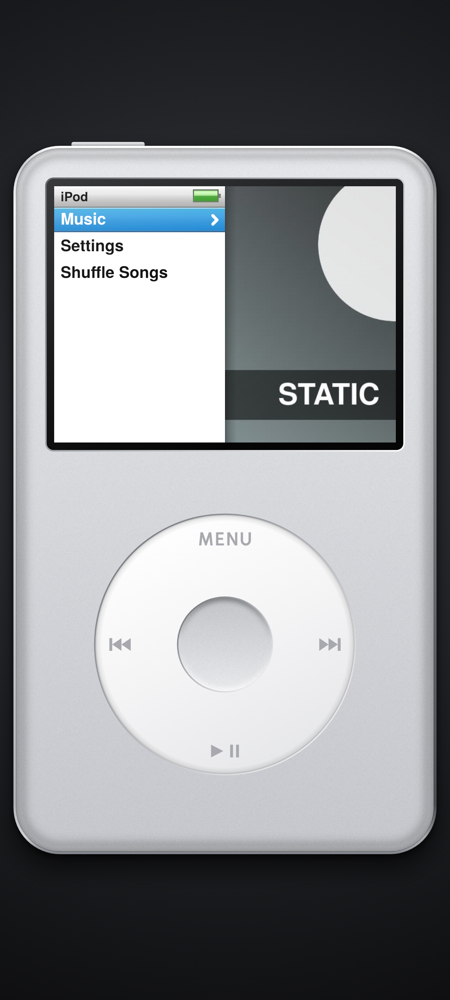
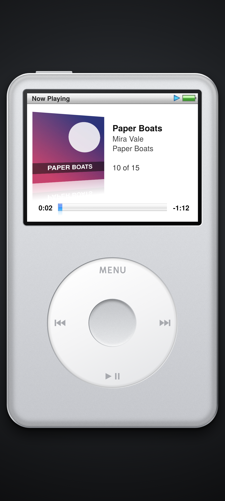

# Pod

A click-wheel music player that looks like the iPod classic: an Android app that plays the music on your phone, and a web version that plays Apple Music's most-played songs.

**Web player:** https://fordpepper.github.io/pod/ · **Android app:** [latest release](https://github.com/fordpepper/pod/releases/latest)

| Menu | Now Playing |
| --- | --- |
|  |  |

## Using it

- Circle the wheel to scroll (haptic tick and click per step). Tap MENU / next / previous / play-pause on the wheel, and the centre button to select.
- Hold MENU to jump to the main menu; hold next/previous to wind through the song.
- In Now Playing the wheel changes volume; press the centre button first to scrub.
- Settings: Shuffle, Repeat, Clicker.
- Most of the time it's silver; now and then you get the black one, or the rare red one (10% each).
- Web on a desktop: arrow keys or mouse wheel to scroll, Enter to select, Esc for Menu, Space to play/pause.

## Android app

- Lists every song in the phone's media library: Music > Artists / Albums / Songs, Shuffle Songs, Now Playing.
- Keeps playing in the background and with the screen locked. Android sees what's playing: lock screen, notification and quick-settings controls, headset/Bluetooth buttons. Unplugging headphones pauses, and calls pause and then resume.
- Needs Android 8.0+. Install `pod.apk` from the releases page (allow installing from unknown sources), or `adb install -r pod.apk`.
- Build: `./build.sh` (needs the Android SDK at `~/android-sdk` with build-tools 34.0.0 and platform android-34, plus a debug keystore). No Gradle.

## Web player

- Plays the 30-second previews of Apple Music's 100 most-played songs (US chart), via Apple's public RSS chart feed and the iTunes lookup API. No account or key needed.
- `.github/workflows/chart.yml` refreshes `docs/top.json` daily (`tools/fetch_chart.py`).
- Uses the Media Session API, so phones show the song on the lock screen and headset buttons work.
- `docs/pod.js` is a port of the Android drawing code.

## Notes

- The body is drawn from the real dimensions in millimetres (`Hardware.java`); the screen is drawn in the original 320×240 grid (`PodView.java`).
- Fonts: TeX Gyre Heros (GUST Font License, see `assets/FONT-LICENSE.txt`).
- Unofficial fan project, not affiliated with or endorsed by Apple. Song previews and artwork courtesy of Apple Music.
